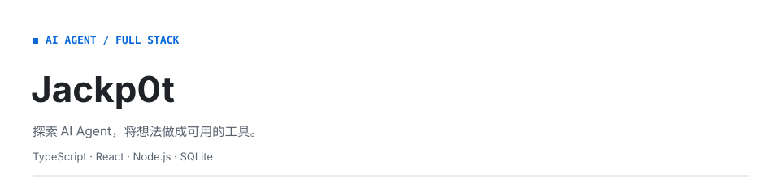
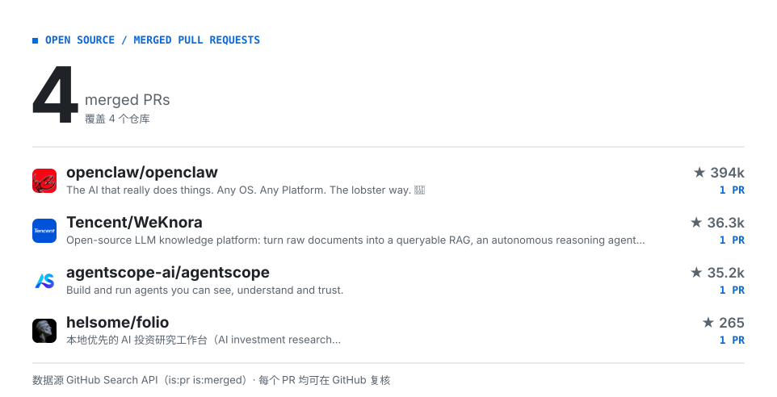

<picture>
  <source media="(prefers-color-scheme: dark)" srcset="./assets/hero-dark.svg">
  
</picture>

<!-- CONTRIB:BEGIN -->
<picture>
  <source media="(prefers-color-scheme: dark)" srcset="./assets/contrib-dark.svg">
  
</picture>
<!-- CONTRIB:END -->

## 代表作品

- **[TaskCopilot · 作息簿](<https://github.com/Jackkp0t/TaskCopilot>)**：智能计划助手：自然语言任务草稿、任务拆解与摘要，支持确认后写入和 SSE 事件回放。
- **[Folio · 开源参与](<https://github.com/helsome/folio/pull/97>)**：为开源 AI 投资研究工作台贡献修复，PR \#97 已合并。
- **[agentlearning](<https://github.com/Jackkp0t/agentlearning>)**：Agent 学习记录。

## 更多信息

[个人博客](<https://jackkp0t.github.io/>) · [GitHub](<https://github.com/Jackkp0t>)
